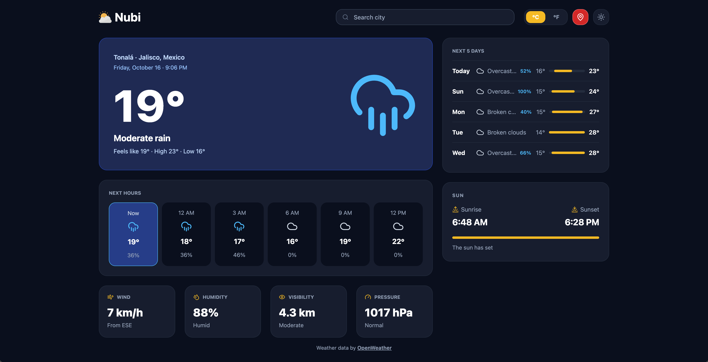

<div align="center">


# Nubi

Real-time weather with city search, geolocation and light/dark themes.

[Live demo](https://nubi-weather-sxc.vercel.app) · [Report a bug](https://github.com/softXcruz/Nubi-weather-app/issues)




</div>

## About

I built this to practice working with a real API end to end: search with autocomplete, geolocation, loading and error states, light and dark themes, and a deploy that keeps the API key out of the browser.

## What it does

- Shows current conditions, the next few hours, a 5-day forecast, wind, humidity, visibility, pressure and sunrise/sunset.
- Searches cities as you type and lets you pick from a list, including keyboard navigation (arrow keys, Enter, Escape).
- Asks for your location on the first visit and lets you jump back to it with one button. If you decline, you can search instead.
- Switches between °C and °F instantly, without a new request.
- Follows your system theme, or whatever you picked last, in light and dark.
- Works on phones. The header, cards and hourly strip all reflow below 768 px.

## Stack

- React 19 and TypeScript
- Vite
- Tailwind CSS v4
- OpenWeather API (geocoding, current weather, 5-day forecast)
- Vercel, with one serverless function as an API proxy
- lucide-react for icons

## How it's put together

<details>
<summary>Project structure</summary>

```
src/
  components/   UI pieces (SearchBar, CurrentWeather, HourlyForecast, ...)
  hook/         useCitySearch, useCurrentWeather, useForecast, useOwnLocation, useTheme
  services/     openWeather.ts, the only file that talks to the API
  utils/        formatting, unit conversion, grouping forecast entries by day
  types/        shared TypeScript types
api/
  weather.ts    serverless proxy used in production
```

</details>

## Credits

Weather data from [OpenWeather](https://openweathermap.org/).

Built by [Your name](https://github.com/softXcruz).
